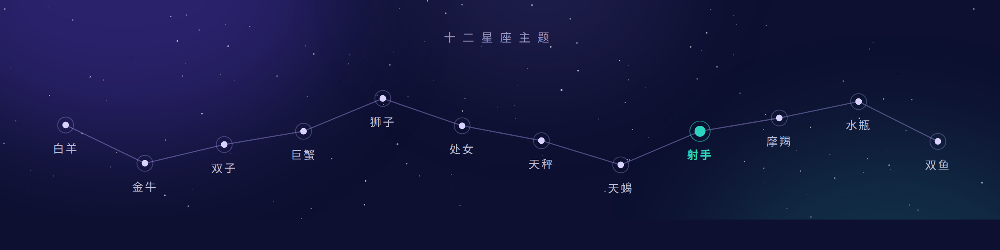
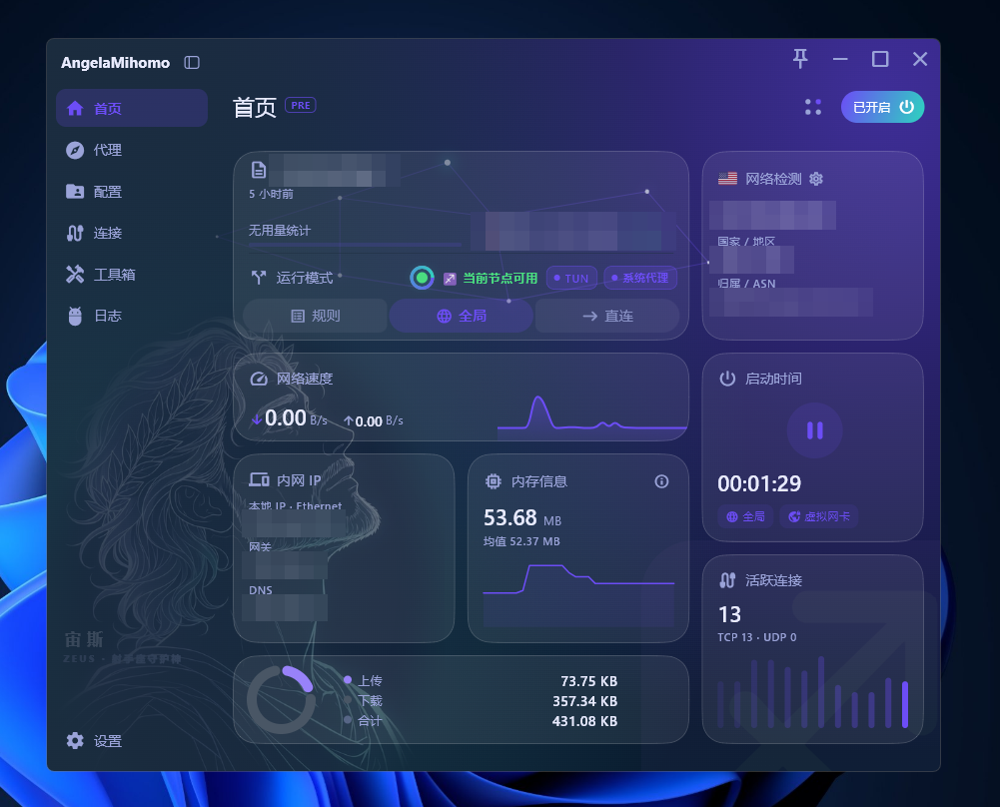
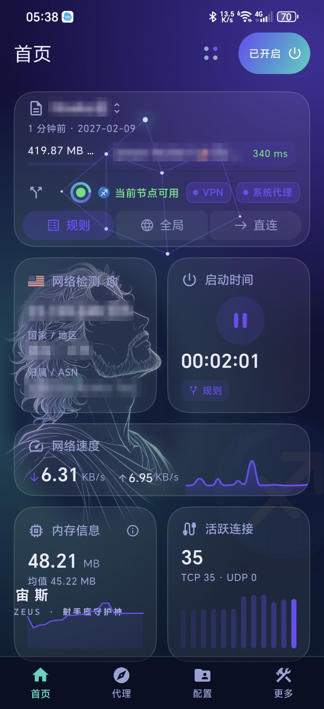
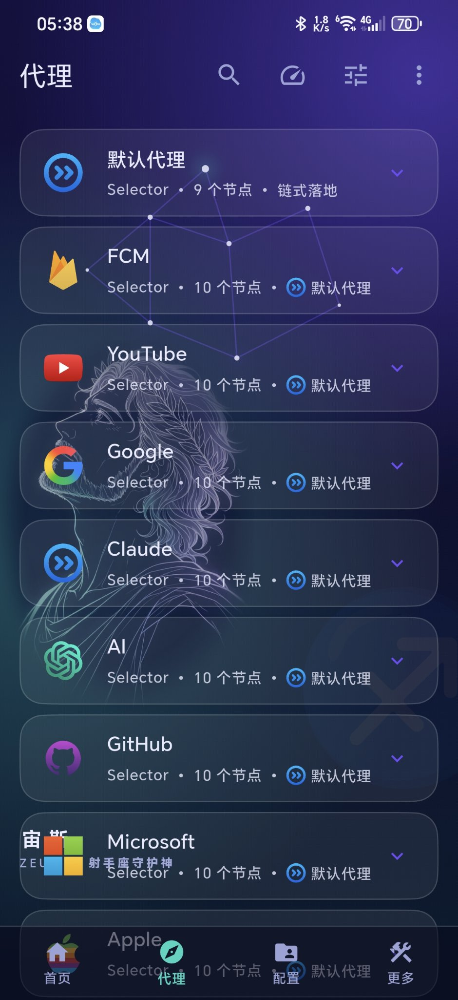
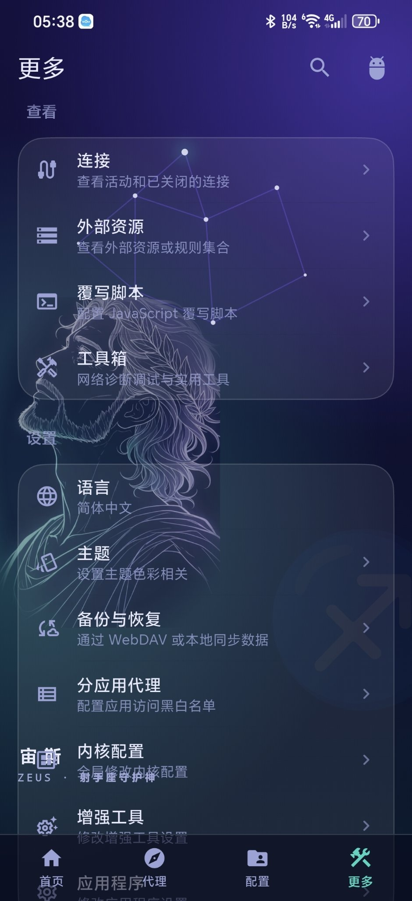

<p align="center">
  
</p>

<h4 align="right">
  <strong>简⁠体⁠中⁠文</strong> | <a href="readme/README_en.md">English</a> | <a href="readme/README_ru.md">Русский</a> | <a href="readme/README_fa.md">فارسی</a> | <a href="readme/README_ja.md">日⁠本⁠語</a> | <a href="readme/README_ko.md">한⁠국⁠어</a>
</h4>

<h1 align="center">♐ Angela Mihomo</h1>
<p align="center">
  <strong>十二星座主题的 Mihomo 客户端</strong><br/>
  默认主题：射手座 · 靛夜飞箭
</p>

## 关于本项目

**Angela Mihomo** 是一款基于 [Mihomo](https://github.com/MetaCubeX/mihomo) 内核的跨平台代理客户端，覆盖 Android、Windows、macOS、Linux 四个平台，同版本、一套功能、同步发布。它的设计语言是十二星座主题家族：十二套星座主题各有自己的配色与星图，一套设计走到底，界面浮在星野光场之上。

本项目的四条产品准则：

* **易用**：导入订阅即可直接跑起来，不要求使用者先懂概念。
* **系统显式**：内核能做的都摆到界面上，每项能力带说明与出处，不藏着掖着。
* **隐私本地优先**：能只留本机的只留本机，日志与数据先脱敏再落盘。
* **长期平稳**：连接稳定、订阅更新可靠、测速准确、模式与分流正确，先于一切锦上添花。

遵循 GPL-3.0 开源协议，独立开发与发布。

<p align="center">
  
  
</p>
<p align="center"><sub>真机实拍：Windows 与 Android 首页（敏感信息已打码）</sub></p>

### 界面实拍

<p align="center">
  
  
</p>
<p align="center"><sub>代理页与更多页实拍（Android）</sub></p>

### 📣 发布频道

版本发布与更新通知见 Telegram 频道：https://t.me/AngelaNexus

使用交流与问题反馈见 Telegram 群组：https://t.me/AngelaMihomoGroup

---
## ✨ 本版夺目点：十二星座之星辰大海

* **十二位守护神**：每套星座主题都有一位守护神融入每一页背景——左下偏上，仰望顶部本星座星图，名字融入背景；同一位守护神全页同一人物、造型随页而变；形象与名字同为背景层，不遮挡内容。
* **十二套星座主题**：白羊、金牛、双子、巨蟹、狮子、处女、天秤、天蝎、射手、摩羯、水瓶、双鱼，每套取星座的元素与意象配色；全家族共用一套设计语言，不分深浅两态，靛夜星野就是正本。
* **默认射手座 · 靛夜飞箭**：靛夜底色、飞箭轨迹与茶壶星群，是打开应用的第一眼。
* **星野光场界面**：卡片以半透玻璃浮在星图之上，星图透卡可见；主题切换只换令牌，全应用随之变装。

---
## 🚀 核心能力

* **链式代理**：真链式——入口跳点与出口落点都可选用策略组，出口可跨配置选择；入口失效时整条链断开，绝不绕开入口直连。
* **系统显式（中国自适应性）**：WebRTC 拦截、中国公共 DNS 直连、广告拦截等一整套显式规则，与链式代理统一联动，开箱即生效；其中拦截类规则在规则、全局、直连三种模式下都生效。
* **规则模式默认到位**：规则模式下中国流量直连、非中国流量走代理，由应用注入的规则保证，不被订阅规则穿透。
* **DNS 仲裁**：覆写开启时，应用的 DNS 设置全局生效；关闭时，订阅配置自带的 DNS 生效。任一时刻只有一套规则说了算，不冲突、不重复。
* **隐私本地优先**：出口 IP 的国家、地区、ASN、运营商全部由本地数据库查询得出，零外发；无广告、无统计收集；更新检查只指向本仓库。
* **托管模式内置脚本**：为配置开启托管模式后，内置脚本自动生成代理组与规则；新装与已有配置都不会被默认开启，按配置自愿开启。脚本内容可按需自定义，正本随本仓库维护、更新随 App 版本走。
* **首页合并卡与状态提示灯**：当前配置、运行模式与节点状态集中在一张固定置顶的卡片上，不会被误删、误缩放；提示灯实时显示当前节点可用状态（绿可用、红不可用、灰未测），点灯即测速。
* **启动自动测速**：每次开启服务后自动执行一次全局联动测速，只测不选、不改动你的节点选择，开局即是真实延迟与可用状态。
* **配置状态一目了然**：配置卡直接标明托管与链式状况——托管开启才显示标记；链式启用且入口、出口两端引用完整显绿，任一端失效显红，问题配置不用点进去才发现。
* **失败明示**：操作失败时，提示会写清具体原因与解决办法——例如链式引用失效会指明是哪一端失效、该去哪里重新选择，不让用户对着一句「失败」猜。
* **独立包名**：Android 包名为 `app.angelabettbox`，可与其他同类客户端并存安装，互不影响；包名保持稳定，已安装版本可直接覆盖升级。
* **版本与内核跟进**：内核基线与 Mihomo 官方版本对齐（当前为 Mihomo v1.19.34），内置规则数据源采用 MetaCubeX 官方源。

---
## 🛠️ 安装与下载

请前往本仓库的 **[[Releases]](https://github.com/dukangalex/AngelaMihomo/releases)** 页面下载对应平台的安装包：

* **桌面端支持**:
  * **Windows 8.1+:** (x64 / arm64)
  * **Linux Kernel 5.4+:** (x64 / arm64)
  * **macOS 12.0+:** (Intel / Apple Silicon)
* **移动端及其他**:
  * **Android 8.0+:** (ARMv8 / ARMv7 / x86_64 / Universal)
  * **Android TV:** 完整大屏适配，可选 ARMv7 32位版本

**分发说明**：本项目仅通过 GitHub Releases 分发，未上架应用商店；Windows 安装包未做商业代码签名，macOS 安装包未经 Apple 公证，首次打开请按下方常见问题处理。

**从其他版本迁移（Android）**：自 v1.19.7-chain.1 起本应用使用独立包名，可直接与其他版本并存安装；如需迁移数据，请先在原应用中导出备份，再在本应用中导入恢复。

---
## 💡 常见问题

1. **安装环境与兼容版本**：
   - 安卓端设备请检查是否授予了充足的后台运行权限，系统需满足 Android 8.0+。
   - 桌面端老旧硬件请根据 CPU 指令集架构选择对应的 Compatible 兼容版本。
   - 安全相关：本项目全流程开源透明，零隐私收集；可对照本仓库源码自行核查。

2. **桌面端权限与 TUN**：
   - Windows 端管理员权限安装包已内置处理，日常使用无需手动再次授权。
   - macOS / Linux 开启 TUN 虚拟网卡时，请在系统提示时输入正确的系统密码以完成授权。
   - 如遇其他报错，请先确认后台没有其他代理工具冲突占用端口，并附带 Debug 日志提交反馈。

3. **macOS 首次安装指南**：
   - 根据平台 (Intel / Apple Silicon) 下载并打开 `.dmg` 安装包，将 Angela Mihomo 图标拖入 Applications 文件夹。
   - **避开系统安全拦截**（本项目未购买 Apple 商业开发者证书）：
     - **推荐**：在“访达 - 应用程序”中，**右键点击 Angela Mihomo 图标选择“打开”**，在系统弹窗中确认点击“打开”即可。
     - **备选**：若被阻止，可前往系统“设置 -> 隐私与安全性”，找到 Angela Mihomo 点击“仍要打开”。
   - 首次开启 TUN 模式时，系统会提示密码授权，请输入密码允许创建虚拟网络接口。

4. **订阅导入与排障**：
   - 若导入失败，请优先在服务商后台重置订阅链接后重新尝试。
   - 如持续异常，请先向节点服务商核对节点格式，确认属客户端问题可随时提交 Issue。

---
## 💻 开发构建与 UI 适配

本项目的环境准备、回归测试和 Linux 构建说明见 [DEVELOPMENT.md](DEVELOPMENT.md)。

以 Windows 平台构建为例：

* 系统需求：Windows 10 及以上
* 依赖环境：Git, Visual Studio, Flutter 3.47.x, Golang, Inno Setup, Rust
```bash
* flutter pub get (获取相关依赖)
* dart .\setup.dart windows --arch amd64 --out core (仅构建Core核心)
* dart .\setup.dart windows --arch amd64 --out app --compatible (可选兼容版本)
* 构建完成后，最终产物位于 `dist/` 目录
```

自定义脚本 UI 适配：

* 本项目支持外置覆写脚本适配图形化 UI：在脚本首行添加以下声明，即可直接联动内置可视化开关：
* <code>const Compatible_With_AngelaMihomo = { ruleOptionsEnable: true };</code>（本项目声明）
* Mihomo 系通用声明同样受支持：<code>const Compatible_With_Mihomo = { ruleOptionsEnable: true };</code>（任何支持该约定的 Mihomo 客户端均可识别）
* Bettbox 声明同样受支持：<code>const Compatible_With_Bettbox = { ruleOptionsEnable: true };</code>
* 若脚本开关中包含策略组与其他功能开关，可通过 `policyGroupOptions` 声明策略组开关名称；未声明的开关会自动归纳至「⚙️ 其他设置」二级菜单：

```js
const Compatible_With_AngelaMihomo = {
  ruleOptionsEnable: true,
  // 声明属于策略组的开关名称，需与 ruleOptionsEnable 的键完全一致
  policyGroupOptions: ['🚀 节点选择', '🛑 广告拦截'],
};
```
* 未声明 `policyGroupOptions` 或名称不匹配时，所有开关将平铺展示。

---
## ❤️ 致谢

* **[Bettbox](https://github.com/appshubcc/Bettbox)**（原项目，本分支基于它二次开发，感谢 appshubcc 与所有上游贡献者）
* **[FlClash GUI](https://github.com/chen08209/FlClash)**（谱系起源，向原作者的开创性探索与贡献致敬）
* **[Mihomo Core](https://github.com/MetaCubeX/mihomo)**（强大灵活的核心驱动）
* **[HiClash](https://github.com/dukangalex/HiClash)**（本项目内置托管脚本的来源；脚本正本现随本仓库 `assets/scripts/managed.js` 维护，更新随 App 版本走）
* **[MyClash](https://github.com/AIsouler/MyClash)**（AIsouler 的脚本/配置分享，HiClash 的上游谱系来源）
* **[Qure 图标集](https://github.com/Koolson/Qure)**（托管模式的路由与服务图标来源；图标已全量收进本仓库 `assets/route_svg/` 随包分发）

以及以下开源项目的启发与使用参考：

[Zashboard](https://github.com/Zephyruso/zashboard), [CMFA](https://github.com/MetaCubeX/ClashMetaForAndroid), [Sparkle](https://github.com/xishang0128/sparkle), [SFA](https://github.com/SagerNet/sing-box-for-android), [HUSI](https://github.com/xchacha20-poly1305/husi), [V2rayN](https://github.com/2dust/v2rayN)

---
## 📄 开源协议

本项目采用 [GPL-3.0 License](LICENSE) 开源协议发布，完整源码即本仓库。
