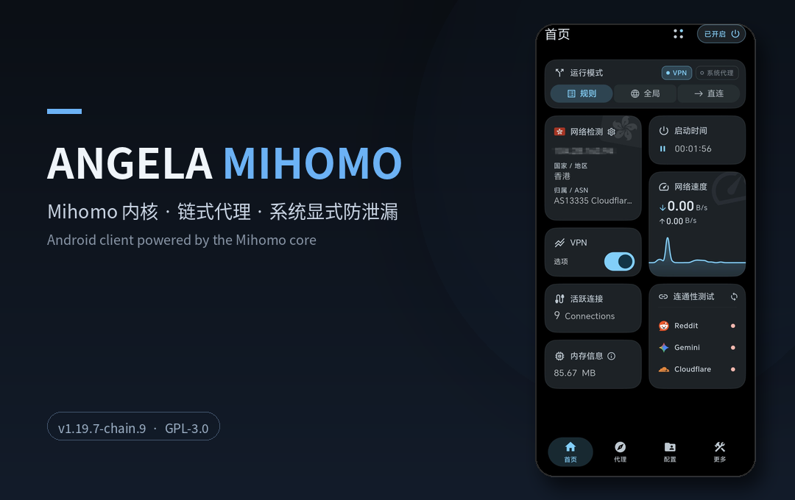

<h4 align="right">
  <strong>简体中文</strong> | <a href="readme/README_en.md">English</a> | <a href="readme/README_ru.md">Русский</a> | <a href="readme/README_fa.md">فارسی</a> | <a href="readme/README_ja.md">日本語</a> | <a href="readme/README_ko.md">한국어</a>
</h4>

<h1 align="center">⚡ Angela Mihomo</h1>
<p align="center">
  <strong>链式代理增强版 Mihomo 客户端</strong>
</p>

## 关于本项目

**Angela Mihomo** 是一款基于 [Mihomo](https://github.com/MetaCubeX/mihomo) 内核的跨平台代理客户端，专注链式代理、系统级防泄漏与开箱即用体验，遵循 GPL-3.0 开源协议，独立开发与发布。

本项目的特色：

* **链式代理增强**：入口与出口均可选用策略组作为跳点；出口可跨配置选择（节点或策略组）；入口组为空时自动加固为拒绝直连，避免链式失效时流量绕行直连。
* **独立包名**：Android 包名为 `app.angelabettbox`，可与其他同类客户端并存安装，互不影响；包名保持稳定，已安装版本可直接覆盖升级。
* **版本与内核跟进**：内核基线与 Mihomo 官方版本对齐（当前为 Mihomo v1.19.33），内置规则数据源采用 MetaCubeX 官方源。
* **系统显式防泄漏**：WebRTC 拦截、中国公共 DNS 直连、广告拦截等一整套显式规则，与链式代理统一联动，开箱即生效。

<p align="center">
  
</p>

### 📣 发布频道

版本发布与更新通知见 Telegram 频道：https://t.me/AngelaNexus

使用交流与问题反馈见 Telegram 群组：https://t.me/AngelaMihomoGroup

---
## 🚀 核心特性

* **开箱即用**：完善的权限引导与舒适的 TUN / VPN 体验，预置大量合理优化策略，安装即达最佳可用状态。
* **轻量畅快**：深度调优系统与渲染管线，前台交互动画高帧率简洁丝滑，移动端低能耗，桌面端低资源占用。
* **安全可信**：内核紧跟 Mihomo 主线，遵循各平台最小权限设计；代码完全开源，可自行审计。
* **稳定容错**：优化多平台极端网络环境下的边界问题，内置双重配置检测验证与保护机制。
* **架构优化**：桌面端原生 ARM64 架构深度支持，同时持续维护面向老旧设备的 Compatible 兼容版本。
* **智能守护**：支持多平台无感智能启停、移动端低功耗休眠策略、一键禁用 QUIC 以及托盘菜单多维快捷控制。
* **可视化设置**：提供丰富深入的可视化参数调节界面，支持改动即时生效。
* **首页小组件**：内置多款 Widget 小组件，在首页直观掌控实时网速、连接与全局运行状态。
* **个性化定制**：支持丰富的色彩主题、自定义图标与标题等，并内置 30 种精美的测速动效。
* **生态与扩展**：支持外置 JS 覆写脚本的可视化 UI 适配与高性能代码编辑器。
* **零隐私风险**：代码完全透明开源、无广告，零后台隐私收集。

---
## 🛠️ 安装与下载

请前往本仓库的 **[[Releases]](https://github.com/dukangalex/AngelaMihomo/releases)** 页面下载对应平台的安装包：

* **桌面端支持**: 
  * **Windows 8.1+:** (x64 / arm64)
  * **Linux Kernel 5.4+:** (x64 / arm64)
  * **macOS 12.0+:** (Intel / Apple Silicon)
* **移动端及其他**: 
  * **Android 8.0+:** (ARMv8 / ARMv7 / x86_64 / Universal) 
  * **Android TV:** 完整大屏适配，可选 ARMv7 32位版本
  * **鸿蒙 NEXT:** 可配合 [[卓易通]](https://harmonyos.cool/android-app) 稳定使用

**从其他版本迁移（Android）**：自 v1.19.7-chain.1 起本应用使用独立包名，可直接与其他版本并存安装；如需迁移数据，请先在原应用中导出备份，再在本应用中导入恢复。

---
---

## 📦 分发与安全性

[English version below](#distribution--security-english)

我们把目前的分发状态如实写在这里，不回避短板；安全性则给出可以逐项核对的事实。

**分发现状（短板明示）**

* 本项目仅通过 GitHub Releases 分发，未上架 Google Play、App Store、Microsoft Store 等任何官方应用商店。
* Windows 安装包目前尚未做代码签名，首次安装时系统 SmartScreen 会给出安全提示，需要手动确认后继续。
* macOS 安装包为临时签名，尚未做 Apple 公证，首次打开时系统会拦截，需要在系统设置中手动放行。
* Android 为直接安装 APK，部分手机厂商的安全扫描会对这类安装给出风险提示。

以上提示都来自分发形态，而不是应用本身被发现存在安全问题。

**安全性（可核对）**

* **全开源**：源代码以 GPL-3.0 许可证公开，发布包由 GitHub Actions 从公开源码自动构建，您安装的二进制与您能读到的代码一一对应。
* **可校验**：每个安装包的 SHA-256 摘要都显示在 GitHub 发布页对应文件的资产信息中，下载后可与本地计算值比对；Android 正式签名证书的 SHA-256 指纹为 `70128cacee64c4620a840c1626d806351149e85222fd3e00312e0771e6fd3f5e`，安装前可核对。
* **不收集数据**：应用无广告、无遥测、不收集使用数据；更新检查仅访问 GitHub。
* **密钥隔离**：正式签名私钥仅保存在 CI 密钥中，不进入代码仓库。
* **发版门槛**：每个版本发布前，都要在模拟器中导入真实形态的订阅做全功能实测，通过后才发布。

平台分发的门槛，我们如实告知；属于我们自己的部分——代码、构建与校验——我们按能力范围内最严的标准做。

### Distribution & Security (English)

We state our current distribution status plainly, including its shortcomings, and give verifiable facts about security.

**Distribution status (limitations, stated openly)**

* This project is distributed only through GitHub Releases. It is not listed on Google Play, the App Store, the Microsoft Store, or any other official app store.
* Windows installers are not yet code-signed. SmartScreen will show a security prompt on first install, which requires manual confirmation to continue.
* macOS packages are ad-hoc signed and not yet notarized with Apple. Gatekeeper will block the first launch until you allow it manually in System Settings.
* Android is installed by sideloading the APK. Some phone vendors' security scanners show risk prompts for this kind of installation.

These prompts come from the distribution method, not from any known security problem in the app itself.

**Security (verifiable)**

* **Fully open source**: the source code is public under GPL-3.0, and release packages are built automatically by GitHub Actions from that public source — the binary you install corresponds to the code you can read.
* **Verifiable**: the SHA-256 digest of every package is shown in the asset details on the GitHub release page; compare it with the value you compute locally after downloading. The Android release signing certificate's SHA-256 fingerprint is `70128cacee64c4620a840c1626d806351149e85222fd3e00312e0771e6fd3f5e`.
* **No data collection**: no ads, no telemetry, no usage data collection; update checks only contact GitHub.
* **Key isolation**: release signing keys exist only in CI secrets, never in the repository.
* **Release gate**: before every release, the build is installed on an emulator and exercised end-to-end with real-world subscriptions.

Where distribution platforms set the limits, we say so. Where the work is ours — code, build, and verification — we hold ourselves to the strictest standard within our reach.

---
## 💡 常见问题

1. **安装环境与兼容版本**：
   - 安卓端设备请检查是否授予了充足的后台运行权限，系统需满足 Android 8.0+。
   - 桌面端老旧硬件请根据 CPU 指令集架构选择对应的 Compatible 兼容版本。
   - 安全相关：本项目全流程开源透明，零隐私收集；可对照本仓库源码自行核查。

2. **桌面端权限与 TUN**：
   - Windows 端管理员权限安装包已内置处理，日常使用无需手动再次授权。
   - macOS / Linux 开启 TUN 虚拟网卡时，请在系统提示时输入正确的系统密码以完成授权。
   - 如遇其他报错，请先确认后台没有其他代理工具冲突占用端口，并附带 Debug 日志提交反馈。

3. **macOS 首次安装指南**：
   - 根据平台 (Intel / Apple Silicon) 下载并打开 `.dmg` 安装包，将 Angela Mihomo 图标拖入 Applications 文件夹。
   - **避开系统安全拦截**（本项目未购买 Apple 商业开发者证书）：
     - **推荐**：在“访达 - 应用程序”中，**右键点击 Angela Mihomo 图标选择“打开”**，在系统弹窗中确认点击“打开”即可。
     - **备选**：若被阻止，可前往系统“设置 -> 隐私与安全性”，找到 Angela Mihomo 点击“仍要打开”。
   - 首次开启 TUN 模式时，系统会提示密码授权，请输入密码允许创建虚拟网络接口。

4. **订阅导入与排障**：
   - 若导入失败，请优先在服务商后台重置订阅链接后重新尝试。
   - 如持续异常，请先向节点服务商核对节点格式，确认属客户端问题可随时提交 Issue。

---
## 💻 开发构建与 UI 适配

本项目的环境准备、回归测试和 Linux 构建说明见 [DEVELOPMENT.md](DEVELOPMENT.md)。

以 Windows 平台构建为例：

* 系统需求：Windows 10 及以上
* 依赖环境：Git, Visual Studio, Flutter 3.47.x, Golang, Inno Setup, Rust
```bash
* flutter pub get (获取相关依赖)
* dart .\setup.dart windows --arch amd64 --out core (仅构建Core核心)
* dart .\setup.dart windows --arch amd64 --out app --compatible (可选兼容版本)
* 构建完成后，最终产物位于 `dist/` 目录
```

自定义脚本 UI 适配：

* 本项目支持外置覆写脚本适配图形化 UI。以 AIsouler 的 **[脚本/配置分享](https://github.com/AIsouler/MyClash)** 为例，只需在脚本首行添加以下声明，即可直接联动内置可视化开关：
* <code>const Compatible_With_Mihomo = { ruleOptionsEnable: true };</code>（Mihomo 系通用声明，任何支持该约定的 Mihomo 客户端均可识别）
* Bettbox 声明同样受支持：<code>const Compatible_With_Bettbox = { ruleOptionsEnable: true };</code>
* 若脚本开关中包含策略组与其他功能开关，可通过 `policyGroupOptions` 声明策略组开关名称；未声明的开关会自动归纳至「⚙️ 其他设置」二级菜单：

```js
const Compatible_With_Mihomo = {
  ruleOptionsEnable: true,
  // 声明属于策略组的开关名称，需与 ruleOptionsEnable 的键完全一致
  policyGroupOptions: ['🚀 节点选择', '🛑 广告拦截'],
};
```
* 未声明 `policyGroupOptions` 或名称不匹配时，所有开关将平铺展示。

---
## ❤️ 致谢

* **[Bettbox](https://github.com/appshubcc/Bettbox)**（原项目，本分支基于它二次开发，感谢 appshubcc 与所有上游贡献者）
* **[FlClash GUI](https://github.com/chen08209/FlClash)**（谱系起源，向原作者的开创性探索与贡献致敬）
* **[Mihomo Core](https://github.com/MetaCubeX/mihomo)**（强大灵活的核心驱动）

以及以下开源项目的启发与使用参考：

[Zashboard](https://github.com/Zephyruso/zashboard), [CMFA](https://github.com/MetaCubeX/ClashMetaForAndroid), [Sparkle](https://github.com/xishang0128/sparkle), [SFA](https://github.com/SagerNet/sing-box-for-android), [HUSI](https://github.com/xchacha20-poly1305/husi), [V2rayN](https://github.com/2dust/v2rayN)

---
## 📄 开源协议

本项目采用 [GPL-3.0 License](LICENSE) 开源协议发布，完整源码即本仓库。
