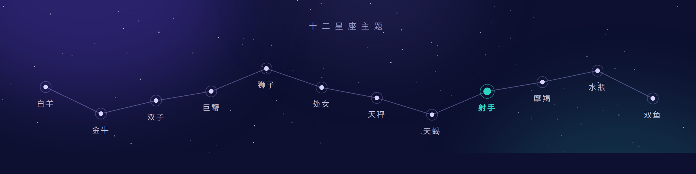
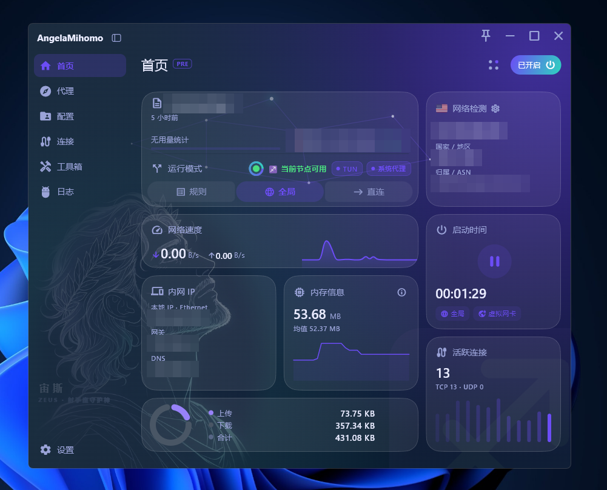
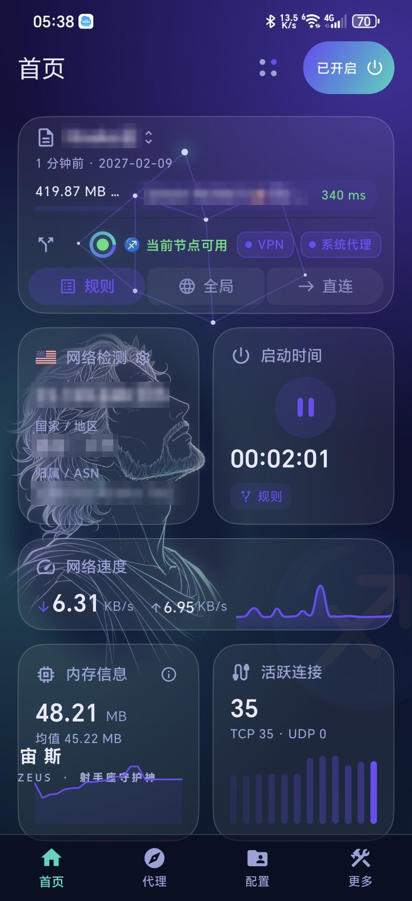
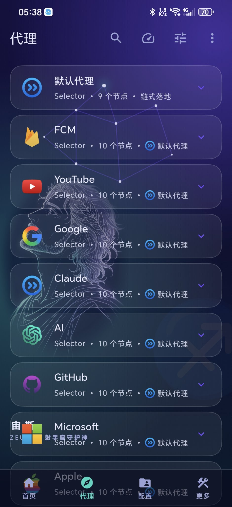
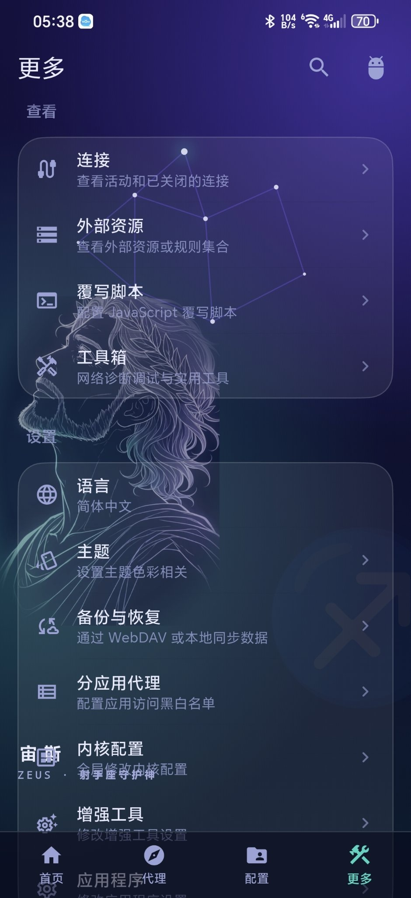

  

<h4 align="right">
  <a href="../README.md">简⁠体⁠中⁠文</a> | <strong>English</strong> | <a href="README_ru.md">Русский</a> | <a href="README_fa.md">فارسی</a> | <a href="README_ja.md">日⁠本⁠語</a> | <a href="README_ko.md">한⁠국⁠어</a>
</h4>

<h1 align="center">♐ Angela Mihomo</h1>

  <strong>A Mihomo client dressed in the Starry Sea theme family</strong> 
  Default theme: Sagittarius · Indigo Night Arrow

## About this project

**Angela Mihomo** is a cross-platform proxy client built on the [Mihomo](https://github.com/MetaCubeX/mihomo) core, shipping one version with one feature set across Android, Windows, macOS and Linux. Its design language is the Starry Sea theme family — three series, thirty-nine themes in all: the Twelve Constellations, Human Deep-Space Exploration, and the Solid Zodiac — sharing one design language with no separate light variant.

The project's first hard rule is its six foundation pillars, equal in rank with none subordinate to another; no trade-off may sacrifice one to serve another, and a genuine conflict means finding a solution that satisfies all six or stopping for the project owner's decision: privacy (user privacy protected to the maximum within our capability — every feature kept, none hollowed out, nothing leaked; see PRIVACY-GUIDELINES.md), data security (configuration, subscriptions, and credentials stored and transferred on a security baseline, credentials encrypted, backups and exports controlled and redacted first), efficiency (restrained resource use that respects memory and battery, never spent on decorative features), stability (reliable connections, dependable subscription updates, accurate speed tests, correct modes and routing, over any decoration), explicit capabilities (every kernel capability on screen, with an explanation and a source), and out-of-the-box usability (import a subscription and it just runs, no concepts to learn first). It is developed and released independently under the GPL-3.0 license.

  
  

Real-device screenshots: home screen on Windows and Android (sensitive details redacted)

  
  

Proxies and More pages on Android

Release announcements: https://t.me/AngelaNexus

Discussion and feedback: https://t.me/AngelaMihomoGroup

Highlights:

* **Self-hosted runtime data**: GEO rules, the city database, ASN data, icons, the rule bundle, the built-in script and the dashboard assets are all distributed from this project's own repositories. External sources serve only as official origins — data is taken from the official source, verified (SHA-256 manifest plus Ed25519 signature), and then served from our own repositories; the app makes no runtime calls to third-party services. Data and the script update themselves daily (on by default, with channel status and failure reasons shown in the app), independent of app releases.
* **The Starry Sea theme family**: three series, thirty-nine themes — the Twelve Constellations (each with its own palette, star chart and guardian; Sagittarius · Indigo Night Arrow is the default), Human Deep-Space Exploration (fifteen historic missions, from Vostok 1 in 1961 to DART in 2022), and the Solid Zodiac (twelve solid-colour themes, each with a faint line-drawn zodiac animal watermark). Switching a theme re-skins the whole app from one token set.
* **True chained proxying**: both the entry hop and the exit landing may be proxy groups, and the exit may be selected from another profile; if the entry dies the whole chain goes down with it — traffic never falls back to a direct connection around the entry.
* **System-explicit rules (China adaptability)**: WebRTC blocking, China public-DNS direct routing, ad blocking and related explicit rules, unified with the chain policy and effective out of the box; the interception rules stay in force in rule, global and direct modes alike. In rule mode, China traffic goes direct and everything else goes through the proxy, guaranteed by app-injected rules that subscription rules cannot pierce.
* **DNS arbitration**: with override on, the app's DNS settings win globally; with it off, the subscription profile's own DNS applies. Exactly one rule set is in charge at any moment — no conflicts, no duplication.
* **Local-first privacy**: the exit IP's country, region, ASN and carrier are resolved from a local database with zero outbound queries; no ads, no telemetry; update checks point only at this repository.
* **Managed mode with a built-in script**: turn managed mode on for a profile and the bundled script generates its proxy groups and rules. It is never enabled by default — not for new installs, not for existing profiles — and is strictly opt-in per profile. The script's content stays customizable; its canonical copy lives in this repository, and devices receive updates through the signed data channel without waiting for an app release.
* **Merged home card and status light**: the current profile, run mode and node status live on one card pinned to the top of the home screen, where it cannot be removed, resized or moved by accident. The status light shows live node availability (green available, red unavailable, grey untested), and tapping it runs a delay test.
* **Automatic delay test on start**: every time the service starts, one global linked delay test runs automatically — measure only, never changing your node selection — so delays and availability are real data from the first second.
* **Profile status at a glance**: profile cards carry managed and chain markers directly. Managed shows only when on; chain shows green when both the entry and exit references are intact, and red when either end has gone stale — no need to open a broken profile to find out.
* **Failures explained**: when an operation fails, the notice states the concrete cause and the remedy — a stale chain reference, for example, names which end went stale and where to re-select it, instead of leaving you guessing at a bare "failed".
* **Independent package identity**: the Android application id is `app.angelamihomo`, so it can be installed alongside other clients. Note: the id changed with chain.26 — users of older builds export their configuration in the old app and import it in the new one once; after that, upgrades install in place again.
* **Core and data alignment**: the bundled Mihomo core tracks official Mihomo releases (currently v1.19.34). All runtime data is distributed from the project's own data repository [angelamihomo-geo](https://github.com/dukangalex/angelamihomo-geo) — official sources only, every file with a hash manifest and a signature, updated by the app daily.

## Downloads

Get packages for your platform from this repository's **[Releases](https://github.com/dukangalex/AngelaMihomo/releases)** page (Windows, Linux, macOS, Android, Android TV). Distribution is GitHub-only: the Windows installer is not commercially code-signed and the macOS build is not notarized.

**Migrating from another build (Android)**: since v1.19.7-chain.1 this app uses its own package name and installs alongside other builds; export a backup in the other app first, then import it here.

## Acknowledgements

* **[Bettbox](https://github.com/appshubcc/Bettbox)** — the original project this codebase descends from; thanks to appshubcc and all contributors.
* **[FlClash](https://github.com/chen08209/FlClash)** — the lineage origin.
* **[Mihomo](https://github.com/MetaCubeX/mihomo)** — the core engine.
* **[HiClash](https://github.com/dukangalex/HiClash)** — the origin of the built-in managed script; the script's canonical copy now lives in this repository at `assets/scripts/managed.js`, and devices receive updates through the data channel.
* **[MyClash](https://github.com/AIsouler/MyClash)** — AIsouler's script and configuration sharing, the upstream lineage of HiClash.
* **[Qure icon set](https://github.com/Koolson/Qure)** — the source of the managed mode's routing and service icons; the icons ship bundled in this repository under `assets/route_svg/`.
* **[MetaCubeX/meta-rules-dat](https://github.com/MetaCubeX/meta-rules-dat)** — the official origin of the GEO rule data (GeoSite, MMDB and related files); the data is distributed, after signature verification, through this project's own data repository.
* **[DB-IP](https://db-ip.com)** — the source of the city-level IP geolocation and ASN data (City Lite / ASN Lite — IP Geolocation by DB-IP, used under CC BY 4.0), distributed through this project's own data repository [angelamihomo-geo](https://github.com/dukangalex/angelamihomo-geo); the app downloads them automatically and answers all lookups locally afterwards.
* **[Scamalytics](https://scamalytics.com)** — the data reference for the IP risk check feature; the feature is off by default and queries only when the user enables it.
* **[Windows Loopback Manager](https://github.com/appshubcc/Windows-Loopback-Manager)** — UWP loopback exemption tool bundled with the Windows build.
* **Bundled fonts** — [JetBrains Mono](https://github.com/JetBrains/JetBrainsMono) (SIL Open Font License 1.1); [Twemoji](https://github.com/twitter/twemoji) graphics (© Twitter, Inc and other contributors, CC BY 4.0; the bundled COLR font is built by Mozilla's [twemoji-colr](https://github.com/mozilla/twemoji-colr), whose code is Apache-2.0); and the Icons icon font (generated with [IcoMoon](https://icomoon.io), © Keyamoon, CC BY 4.0) — full license texts and attribution files ship in `assets/fonts/licenses/`.

Inspiration and references: [Zashboard](https://github.com/Zephyruso/zashboard), [CMFA](https://github.com/MetaCubeX/ClashMetaForAndroid), [Sparkle](https://github.com/xishang0128/sparkle), [SFA](https://github.com/SagerNet/sing-box-for-android), [HUSI](https://github.com/xchacha20-poly1305/husi), [V2rayN](https://github.com/2dust/v2rayN)

## License

GPL-3.0 — see [LICENSE](../LICENSE). Full source lives in this repository.
