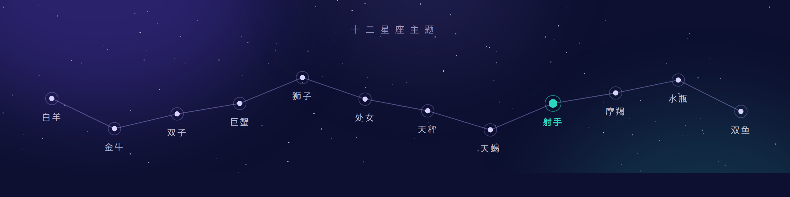

  

<h4 align="right">
  <a href="../README.md">简⁠体⁠中⁠文</a> | <a href="README_en.md">English</a> | <a href="README_ru.md">Русский</a> | <a href="README_fa.md">فارسی</a> | <a href="README_ja.md">日⁠本⁠語</a> | <a href="README_ko.md">한⁠국⁠어</a>
</h4>

<h1 align="center">⚡ Angela Mihomo</h1>

  <strong>链式代理增强版 Mihomo 客户端</strong>

## 关于本项目

**Angela Mihomo** 是一款基于 [Mihomo](https://github.com/MetaCubeX/mihomo) 内核的跨平台代理客户端，专注链式代理、系统级防泄漏与开箱即用体验，遵循 GPL-3.0 开源协议，独立开发与发布。完整文档见 [主 README](../README.md)。

发布频道：https://t.me/AngelaNexus

本项目的特色：

* **十二星座主题**：十二套星座主题同属一套设计语言，不分深浅两态，默认射手座·靛夜飞箭；卡片以半透玻璃浮在星图之上。
* **链式代理增强**：入口与出口均可选用策略组作为跳点；出口可跨配置选择（节点或策略组）；入口组为空时自动加固为拒绝直连，避免链式失效时流量绕行直连。
* **系统显式防泄漏**：WebRTC 拦截、中国公共 DNS 直连、广告拦截等一整套显式规则，与链式代理统一联动，开箱即生效。
* **独立包名**：Android 包名为 `app.angelamihomo`，可与其他同类客户端并存安装，互不影响。注：chain.26 起包名由旧名更换为现名，旧版用户需先在旧版导出配置、再到新版导入，一次迁移后后续版本可直接覆盖升级。
* **版本与内核跟进**：内核基线与 Mihomo 官方版本对齐（当前为 Mihomo v1.19.34）。运行时数据全部由本项目自有数据仓 [angelamihomo-geo](https://github.com/dukangalex/angelamihomo-geo) 分发：源头只取官方发布、每份带哈希清单与签名，App 每日自动更新。

## 安装与下载

请前往本仓库的 **[Releases](https://github.com/dukangalex/AngelaMihomo/releases)** 页面下载对应平台的安装包（Windows、Linux、macOS、Android、Android TV）。

**从其他版本迁移（Android）**：自 v1.19.7-chain.1 起本应用使用独立包名，可直接与其他版本并存安装；如需迁移数据，请先在原应用中导出备份，再在本应用中导入恢复。

## 致谢

* **[Bettbox](https://github.com/appshubcc/Bettbox)**（本项目代码谱系的源头，感谢 appshubcc 与所有贡献者）
* **[FlClash](https://github.com/chen08209/FlClash)**（谱系起源）
* **[Mihomo](https://github.com/MetaCubeX/mihomo)**（核心引擎）
* **[Windows Loopback Manager](https://github.com/appshubcc/Windows-Loopback-Manager)**（Windows 版随包分发的 UWP 回环豁免工具）

## 开源协议

GPL-3.0 — 见 [LICENSE](../LICENSE)。完整源码即本仓库。
